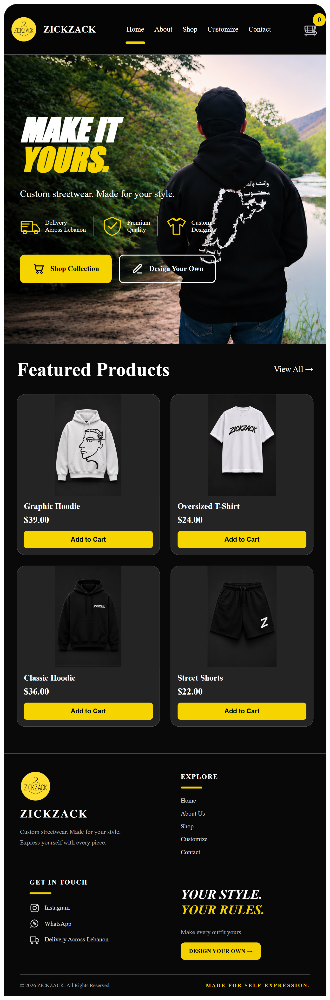
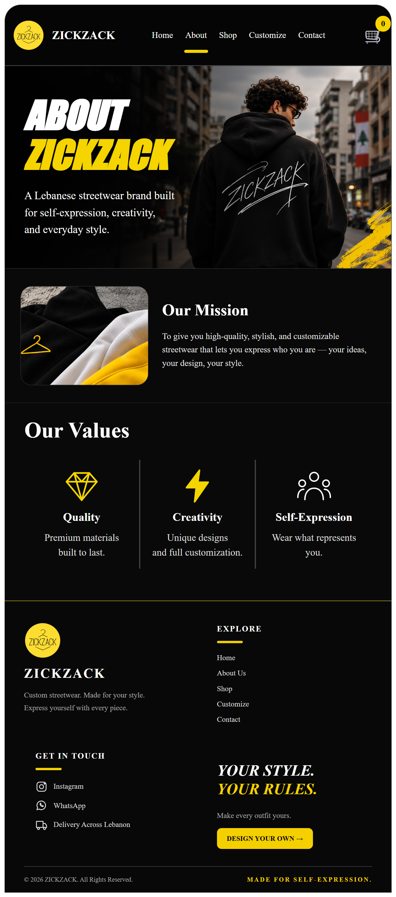
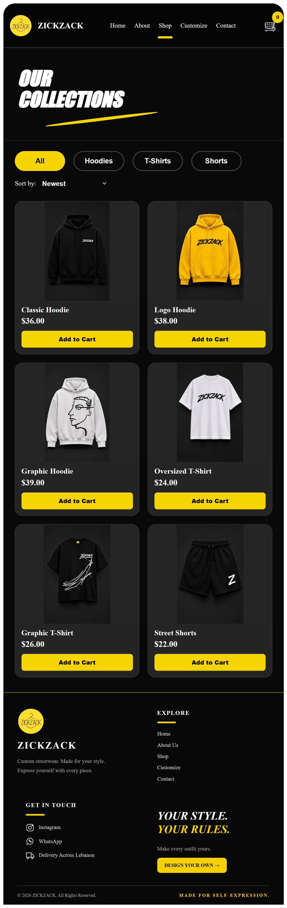
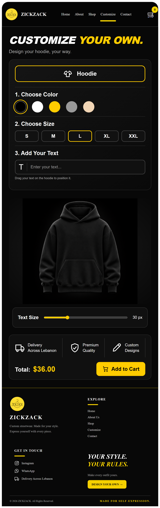
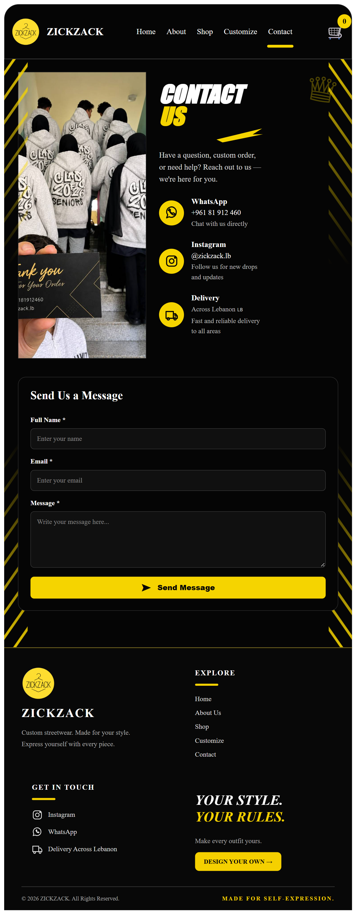
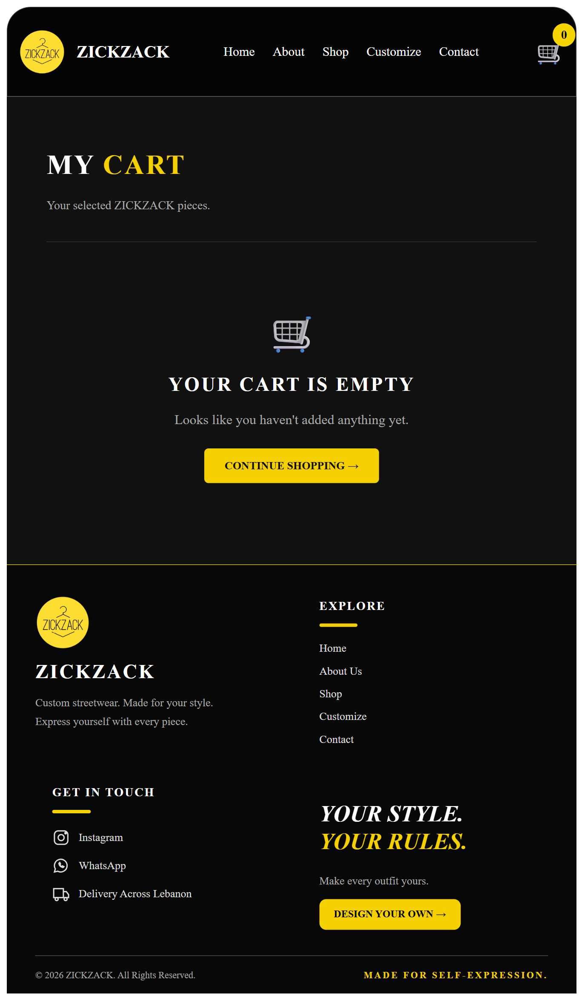

# ZICKZACK – Clothing Website

## 1. Project Description

ZICKZACK is a React-based online clothing website developed as part of the CSCI426 Advanced Web Programming course.

The website allows customers to explore streetwear collections, view products, customize hoodies, and manage their shopping cart.

## 2. Website Features

- Home page with featured products.
- About page introducing ZICKZACK.
- Shop page with product categories.
- Customize page for designing hoodies.
- Contact page with a contact form and social media links.
- Shopping cart with add and remove functionality.
- Responsive design for desktop and mobile devices.

## 3. Technologies Used

- React.js
- JavaScript
- HTML
- CSS
- React Router
- Git and GitHub

## 4. Installation and Setup Instructions

Follow these steps to run the project locally:

1. Clone the repository:

   git clone https://github.com/ahmadkhalil10/zickzack-clothing-website.git

2. Open the project folder:

   cd zickzack-clothing-website

3. Install dependencies:

   npm install

4. Start the development server:

   npm start

5. Open your browser at:

   http://localhost:3000

## 5. Project Screenshots

Screenshots of the website pages will be added here.

- Home Page
- About Page
- Shop Page
- Customize Page
- Contact Page
- Cart Page

## 6. Author

Ahmad Ali Khalil

CSCI426 – Advanced Web Programming
## 5. Project Screenshots

### Home Page

### About Page

### Shop Page

### Customize Page

### Contact Page

### Cart Page
